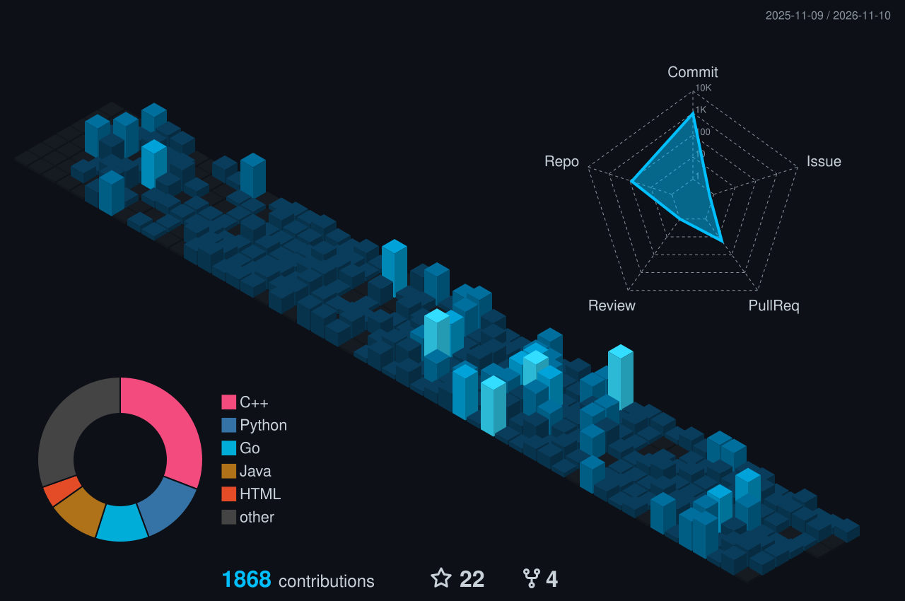

  

  

    
    
    
  

---

## About

I build the parts of a product nobody sees: the APIs, the queues, the GPU pipelines, and the infrastructure that keeps them running.

These days that mostly means AI systems: fine-tuning models, serving them on GPUs at scale, and connecting LLM agents to real products.

I can work across the stack when needed, but backend and AI infrastructure are where I go deep.

## Experience

- **[Nover](https://nover.studio)** · Founding Engineer & Tech Lead *(current)* 
  Built and run the ML stack for an AI image generation platform: fine-tuning diffusion models on H100s, serving them through ComfyUI on autoscaled AWS GPU instances, and the WebSocket APIs and job orchestration around them. Took the product from early development to public waitlist launch.

- **RankUp** · Backend & Data Automation *(EU, remote)* 
  Automated SEO keyword research and clustering with SBERT and DataForSEO, cutting manual strategy work by 40%. Added API cost tracking and structured logging.

- **U LLC** · Software Engineer *(Ohio, remote)* 
  Built a real-time EEG digital twin pipeline on streamed OpenBCI data, and wrote a research paper on Kuramoto-based EEG synchronization.

- **Mind Cloud Robotics** · Chairman & Vice Chairman 
  Led a team of 70+ engineers to 2nd and 3rd place at UGVC and 9th at ERC, and moved the robot software to a distributed ROS 2 setup.

---

## Stack

**Backend & APIs** 
 &nbsp; + gRPC · WebSockets · REST

**AI & ML** 
 &nbsp; + CUDA · Hugging Face · ComfyUI · Modal · LangGraph · LangSmith

**Data & Messaging** 
 &nbsp; + Flink · Airflow · RabbitMQ

**Infrastructure & DevOps** 

**Languages** 

**Also comfortable with**

- **Systems testing:** GoogleTest, libFuzzer, ASan/UBSan, CMake, libpcap, mbedTLS
- **Robotics & embedded:** ROS 2, Arduino, Raspberry Pi, ESP8266, Embedded C
- **Data:** Pandas, NumPy, SciPy
- **Frontend:** React, Next.js, Tailwind (enough to ship a UI over my own APIs)

---

## Projects

### Backend & Infrastructure

- **[Go Distributed Queue](https://github.com/YehiaGewily/Go-distributed-queue)**: Fault-tolerant task queue with crash recovery, priorities, delayed jobs, and dead-letter queues. Chaos-tested. `Go` `Redis` `Prometheus`
- **[Agent Mesh](https://github.com/YehiaGewily/Agent-Mesh)**: Orchestration engine handling 750+ requests/sec under 200 ms, with a live 60 Hz React dashboard. `Go` `Redis` `React` `WebSockets`
- **[EnvGuardian](https://github.com/YehiaGewily/EnvGuardian)**: Keeps `.env` files encrypted in Git using age/SSH keys, with signed changes, safe key rotation, and 80%+ test coverage. `Go` `age` `Cobra`
- **[Real-Time Arbitrage Engine](https://github.com/YehiaGewily/real-time-arbitrage-engine)**: Streams Coinbase and Binance prices through Kafka, spots BTC price gaps with Flink, and sends alerts to Discord and a dashboard. `Python` `Kafka` `Flink` `Docker`

### AI & ML

- **[Nabda](https://github.com/Nabda-Project)** *(capstone)*: Heart-monitoring platform with a custom ESP8266 wearable and real-time alerts, plus an Arabic clinical intake and diagnostic assistant built on a fine-tuned Qwen3-4B. `Qwen3-4B` `Fine-tuning` `Spring Boot` `Flutter` `Next.js`
- **[Agentic LLM Architectures](https://github.com/YehiaGewily/Agentic-LLM-Architectures)**: 12 agent design patterns (reflection, planning, tool use, multi-agent) built as reusable LangGraph workflows, with retrieval, web search, and tracing. `Python` `LangGraph` `Chroma` `LangSmith`
- **[Physics-AI Bridge](https://github.com/YehiaGewily/Physics-AI-Bridge)**: 2D Ising model simulation, extended to Hopfield networks for associative memory. `Python` `NumPy`

### Systems & Simulation

- **[CerebralFlow](https://github.com/YehiaGewily/CerebralFlow)**: Rebuilds brain networks from signals and simulates them as coupled oscillators. `Python` `SciPy`

- **[NetProbe](https://github.com/YehiaGewily/netprobe-cpp)**: Network traffic analyzer with live capture, QUIC SNI decryption, GeoIP lookup, per-process tracking, and a desktop dashboard. `C++20` `Npcap` `Dear ImGui`
- **[THAAD Simulation](https://github.com/YehiaGewily/THAAD-Simulation)**: 3D missile interceptor simulation with Kalman-filtered radar tracking and replayable engagements. `Python` `NumPy`

### Small Tools

- **[Fourier Epicycle Machine](https://github.com/YehiaGewily/The-Fourier-Epicycle-Drawing-Machine)**: Draw any shape and watch rotating circles redraw it in real time. `JavaScript` `p5.js`
- **[dot-spend](https://github.com/YehiaGewily/dot-spend)**: Minimal terminal expense tracker with ASCII charts and CSV export. `Python`

---

## GitHub Stats

  
  
   
  
   
  

---

  <em>Building infrastructure that has to actually work? I'd love to hear about it.</em>
    
  <a href="mailto:yehiasaidgewily@gmail.com"><strong>yehiasaidgewily@gmail.com</strong></a>

